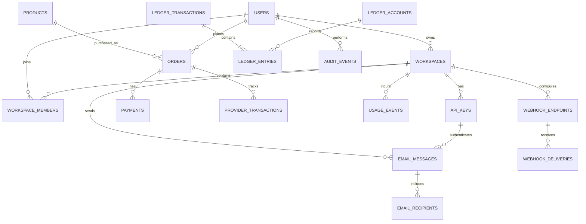

# Entity Relationship Design (ERD)

## 1. Modeling rules

PostgreSQL is a recommended transactional source of truth. Use UUID/ULID identifiers, UTC timestamps, explicit currency codes and integer minor units for money. Orders should retain a price snapshot. Credentials should be revocable, not recoverable.

## 2. Core entities

- `users(id, email, password_hash_or_identity_provider, status, verified_at, created_at)`
- `workspaces(id, owner_user_id, name, status, created_at)`
- `workspace_members(id, workspace_id, user_id, role, status)`
- `api_keys(id, workspace_id, name, prefix, secret_hash, scopes, environment, expires_at, last_used_at, revoked_at, created_by)`
- `products(id, category, provider_product_code, network, name, denomination_or_plan, cost_minor, sell_minor, currency, active, updated_at)`
- `orders(id, user_id, product_id, recipient, price_snapshot_minor, currency, status, idempotency_key_hash, provider_id, provider_reference, created_at, updated_at)`
- `payments(id, order_id, processor, processor_reference, amount_minor, currency, status, verified_at)`
- `provider_transactions(id, provider, external_reference, operation_type, request_hash, status, response_code, created_at, updated_at)`
- `ledger_accounts(id, owner_type, owner_id, currency, account_type)`
- `ledger_transactions(id, reference_type, reference_id, reason, actor_id, created_at)`
- `ledger_entries(id, transaction_id, account_id, direction, amount_minor, currency)`
- `email_messages(id, workspace_id, api_key_id, sender, recipient_count, subject_hash_or_policy, status, provider, provider_message_id, billable_units, created_at)`
- `email_recipients(id, message_id, address, status, event_at)`
- `usage_events(id, workspace_id, api_key_id, event_type, quantity, unit, unit_cost_minor, sell_amount_minor, idempotency_ref, occurred_at)`
- `webhook_endpoints(id, workspace_id, url, secret_reference, events, active)`
- `webhook_deliveries(id, endpoint_id, event_id, attempt, status, response_code, next_attempt_at)`
- `audit_events(id, actor_id, action, resource_type, resource_id, request_id, redacted_metadata, created_at)`
- `support_tickets(id, user_id, order_id_or_message_id, status, assigned_to, created_at)`

## 3. Relationships

- User owns many workspaces.
- Workspace and users relate through workspace members.
- Workspace has many API keys, messages, usage events and webhook endpoints.
- Product has many orders; user places many orders.
- Order can have payment and provider transaction records.
- Ledger transaction contains multiple ledger entries; each entry belongs to a ledger account.
- Email message has recipient records.
- Webhook endpoint has many delivery attempts.
- Audit events record actor and resource references.

## 4. Mermaid ER diagram

## 5. Constraints and indexes

Unique constraints: normalized user email; workspace-member pair; key prefix; provider + external reference; endpoint + event ID; scoped idempotency key. Index order/message status and creation time, workspace usage time, and `next_attempt_at` for queued work. Add checks for positive amounts, valid directions and allowed states.

## 6. Data handling

Avoid retaining email bodies by default unless needed. Consider encryption and short retention if content must be stored. Minimize recipient data in logs. Define deletion/export workflows while retaining legally required financial/audit records. Restrict support/admin access to message content.

## 7. Decisions still open

Wallet vs invoice accounting; multi-recipient message model; message/webhook retention; team support in MVP; taxes/fees; partial refunds; catalogue refresh cadence; provider failover history.
